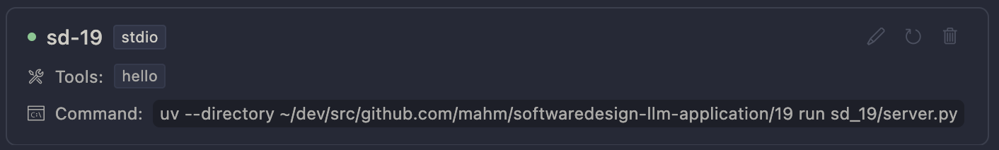

# Software Design誌「実践LLMアプリケーション開発」第19回サンプルコード

## 証明書検証に関する更新（2026年10月22日）

[eMudhraの中間CA侵害](https://emudhra.com/en/post/certificate-security-incident)への対応として、Pythonを紙面に記載した3.12.8から3.12.15へ更新しました。
HTTPS通信に使用するCA証明書も、certifi 2026.10.19へ更新しています。

環境構築にはuv 0.13.4以降を使用してください。
以下の手順で`uv sync`を実行した後、サンプルを起動するシェルで次の環境変数を設定してください。

```bash
export SSL_CERT_FILE="$(uv run python -m certifi)"
export SSL_CERT_DIR="$(dirname "$SSL_CERT_FILE")"
```

## サンプルコードの実行方法

### プロジェクトのセットアップ

※ このプロジェクトは`uv`を使用しています。`uv`のインストール方法については[こちら](https://github.com/astral-sh/uv)をご確認ください。

以下のコマンドを実行し、必要なライブラリのインストールを行って下さい。

```
$ uv sync
```

## 実行方法

以下のコマンドを実行することで、MCPサーバの動作確認を行うことができます。

```bash
uv run python -m sd_19.client
```

## MCPサーバの組み込み方

例えばCursorエディタに本サンプルコードの`sd_19/server.py`をMCPサーバとして組み込みたい場合、以下のように設定します。

| 項目 | 設定値 |
|------|--------|
| Name | sd-19 |
| Type | Command |
| Command | `uv --directory [プロジェクトのディレクトリパス]19 run sd_19/server.py` |

実際にCursorに設定した場合は、以下のように表示されます。（※ Cursor Settings > Features > MCP Servers）


